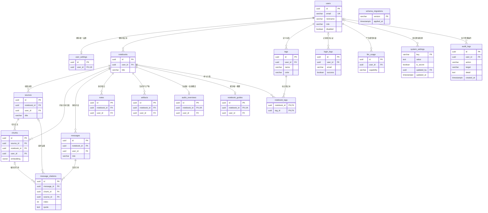

# 知页 KnowNote 数据库设计

版本：T11，2026-11-14。供毕业论文第 4.4 节取材，与 [接口契约](api.md)、`backend/internal/model` 和启动迁移一致。数据字典与索引清单已按本次实际迁移后的 PostgreSQL 系统目录核对。

## 1. 设计范围与总体 E-R 图

采用 PostgreSQL 16 与 pgvector，共 17 张业务表和 1 张迁移版本表。UUID 由应用生成；时间使用 timestamp with time zone，接口统一输出 RFC3339。Base 实体由 GORM 维护 created_at / updated_at；标签和认证日志只有创建时间，引用与关联表不额外增加时间字段。

图中 `||` 表示恰好一个、`o|` 表示零或一个、`o{` 表示零到多个。1:1 关系在物理约束上是 1:0..1（注册保证设置必有，缓存/音频按需创建）；M:N 经关联实体拆成两条 1:N，避免把概念联系误写成直接外键。schema_migrations 为独立运维表，没有业务外键。

图中 sources/chunks/messages/notes/artifacts/audio_overviews/notebook_guides 的 user_id 是复合外键组成部分，并非各自独立指向 users；外键的准确列组以下表为准。

## 2. 实体关系说明

| 起点实体 | 终点实体 | 基数 | 外键或关联键 | 删除策略 | 业务含义 |
|---|---|---|---|---|---|
| users | user_settings | 1:0..1 | user_settings.user_id → users.id | CASCADE | 注册事务创建唯一设置；业务上每用户一条 |
| users | notebooks | 1:N | notebooks.user_id → users.id | CASCADE | 用户拥有个人笔记本 |
| users | tags | 1:N | tags.user_id → users.id | CASCADE | 每用户维护自己的分类标签 |
| users | login_logs | 0..1:N | login_logs.user_id → users.id（可空） | CASCADE | 成功记录归属用户，失败匿名记录无外键归属 |
| users | system_settings | 0..1:N | system_settings.updated_by → users.id（可空） | SET NULL | 配置最后修改者；用户删除保留配置 |
| users | audit_logs | 0..1:N | audit_logs.user_id → users.id（可空） | SET NULL | 管理操作审计；用户删除保留记录 |
| users | llm_usage | 1:N | llm_usage.user_id → users.id | CASCADE | 按用户统计调用、限速与预算 |
| notebooks | sources | 1:N | sources.(notebook_id,user_id) → notebooks.(id,user_id) | CASCADE | 资料按笔记本聚合并约束同用户 |
| notebooks | chunks | 1:N | chunks.(notebook_id,user_id) → notebooks.(id,user_id) | CASCADE | 直接约束检索块的笔记本与归属 |
| notebooks | messages | 1:N | messages.(notebook_id,user_id) → notebooks.(id,user_id) | CASCADE | 笔记本保存对话历史 |
| notebooks | notes | 1:N | notes.(notebook_id,user_id) → notebooks.(id,user_id) | CASCADE | 保存手写、问答或工作室笔记 |
| notebooks | artifacts | 1:N | artifacts.(notebook_id,user_id) → notebooks.(id,user_id) | CASCADE | 保存五类学习产物 |
| notebooks | audio_overviews | 1:0..1 | audio_overviews.(notebook_id,user_id) → notebooks.(id,user_id) | CASCADE | 按需生成，notebook_id 唯一 |
| notebooks | notebook_guides | 1:0..1 | notebook_guides.(notebook_id,user_id) → notebooks.(id,user_id) | CASCADE | 每笔记本至多一条缓存 |
| sources | chunks | 1:N | chunks.(source_id,notebook_id,user_id) → sources.(id,notebook_id,user_id) | CASCADE | 分块必须来自同用户同笔记本的来源 |
| notebooks | notebook_tags | 1:N | notebook_tags.notebook_id → notebooks.id | CASCADE | 删除笔记本自动解除分类 |
| tags | notebook_tags | 1:N | notebook_tags.tag_id → tags.id | CASCADE | 删除标签仅解除关联，不删除笔记本 |
| messages | message_citations | 1:N | message_citations.message_id → messages.id | CASCADE | 引用属于回答；清空历史也清除引用 |
| chunks | message_citations | 0..1:N | message_citations.chunk_id → chunks.id（可空） | SET NULL | 保留历史快照，断开已删除分块定位 |
| sources | message_citations | 0..1:N | message_citations.source_id → sources.id（可空） | SET NULL | 来源删除不抹去已生成回答证据 |
| notebooks | tags | M:N | 通过 notebook_tags 联合主键 (notebook_id,tag_id) | 两端 CASCADE | 一本可有多个标签，一个标签可用于多本 |
| messages | chunks / sources | M:N | 通过 message_citations；(message_id,index) 唯一 | 消息 CASCADE；资料 SET NULL | 一条回答可引多个分块/来源，同一分块/来源可被多次回答引用 |

所有外键沿用默认 ON UPDATE NO ACTION，UUID 不作为可修改业务字段。notebook_tags 不冗余 user_id，由服务在事务中锁笔记本、验证所有标签同属当前用户后整体替换；引用写入同样校验用户/笔记本/来源/分块归属。跨用户业务访问统一返回 404。

## 3. 数据字典

“—”表示无长度限制/不适用；“无”表示数据库未设 DEFAULT，并不代表应用不会赋值。UUID、创建时间和更新时间在应用层写入，无数据库函数默认值。标记“UK 联合”表示参与联合唯一键，单个字段本身未必唯一。SQL 可空属性按实际建表结果列出，接口可能进一步要求非空字符串。

### 3.1 users（用户）

| 字段名 | 类型 | 长度/精度 | 是否可空 | 默认值 | 键 | 说明 |
|---|---|---|---|---|---|---|
| `id` | uuid | 128 位 | 否 | `无` | PK | 实体 UUID；应用创建时生成 |
| `created_at` | timestamptz | 小数秒精度 6 | 否 | `无` | — | 创建时间，由 GORM 写入 |
| `updated_at` | timestamptz | 小数秒精度 6 | 否 | `无` | — | 最近更新时间，由 GORM 维护 |
| `email` | varchar | 254 | 否 | `无` | UK | 规范化邮箱（去空白、转小写） |
| `password_hash` | text | — | 否 | `无` | — | bcrypt 密码哈希，不向客户端返回 |
| `nickname` | varchar | 100 | 否 | `无` | — | 用户昵称 |
| `avatar_url` | text | — | 是 | `无` | — | 头像地址 |
| `role` | varchar | 10 | 否 | `'user'::character varying` | — | user / admin，CHECK 约束及 B-tree 索引 |
| `disabled` | boolean | — | 否 | `false` | — | 停用状态；每次鉴权查库 |

### 3.2 user_settings（用户设置）

| 字段名 | 类型 | 长度/精度 | 是否可空 | 默认值 | 键 | 说明 |
|---|---|---|---|---|---|---|
| `id` | uuid | 128 位 | 否 | `无` | PK | 实体 UUID；应用创建时生成 |
| `created_at` | timestamptz | 小数秒精度 6 | 否 | `无` | — | 创建时间，由 GORM 写入 |
| `updated_at` | timestamptz | 小数秒精度 6 | 否 | `无` | — | 最近更新时间，由 GORM 维护 |
| `user_id` | uuid | 128 位 | 否 | `无` | FK, UK | 所属用户，直接外键引用 users.id |
| `model` | varchar | 200 | 否 | `无` | — | 模型标识 |
| `answer_style` | varchar | 20 | 否 | `'concise'::character varying` | — | 回答风格 concise / detailed / learning |
| `language` | varchar | 20 | 否 | `'zh-CN'::character varying` | — | 回答语言 zh-CN / en-US |

### 3.3 notebooks（笔记本）

| 字段名 | 类型 | 长度/精度 | 是否可空 | 默认值 | 键 | 说明 |
|---|---|---|---|---|---|---|
| `id` | uuid | 128 位 | 否 | `无` | PK, UK 联合 | 实体 UUID；应用创建时生成 |
| `created_at` | timestamptz | 小数秒精度 6 | 否 | `无` | — | 创建时间，由 GORM 写入 |
| `updated_at` | timestamptz | 小数秒精度 6 | 否 | `无` | — | 最近更新时间，由 GORM 维护 |
| `user_id` | uuid | 128 位 | 否 | `无` | FK, UK 联合 | 所属用户，直接外键引用 users.id |
| `title` | varchar | 200 | 否 | `无` | — | 标题 |
| `emoji` | varchar | 32 | 否 | `无` | — | 笔记本图标 |
| `color` | bigint | 64 位整数 | 否 | `无` | — | 卡片色号 0～7，CHECK 约束 |
| `description` | text | — | 否 | `''::text` | — | 笔记本说明 |

### 3.4 tags（标签）

| 字段名 | 类型 | 长度/精度 | 是否可空 | 默认值 | 键 | 说明 |
|---|---|---|---|---|---|---|
| `id` | uuid | 128 位 | 否 | `无` | PK | 实体 UUID；应用创建时生成 |
| `user_id` | uuid | 128 位 | 否 | `无` | FK, UK 联合 | 所属用户，直接外键引用 users.id |
| `name` | varchar | 50 | 否 | `无` | UK 联合 | 标签名，同用户精确匹配唯一 |
| `color` | varchar | 7 | 否 | `'#6750A4'::character varying` | — | 标签颜色 #RRGGBB；接口规范化为大写 |
| `created_at` | timestamptz | 小数秒精度 6 | 否 | `无` | — | 创建时间，由 GORM 写入 |

### 3.5 notebook_tags（笔记本标签关联）

| 字段名 | 类型 | 长度/精度 | 是否可空 | 默认值 | 键 | 说明 |
|---|---|---|---|---|---|---|
| `notebook_id` | uuid | 128 位 | 否 | `无` | PK, FK | 所属笔记本，直接外键引用 notebooks.id |
| `tag_id` | uuid | 128 位 | 否 | `无` | PK, FK | 关联标签 |

### 3.6 sources（来源）

| 字段名 | 类型 | 长度/精度 | 是否可空 | 默认值 | 键 | 说明 |
|---|---|---|---|---|---|---|
| `id` | uuid | 128 位 | 否 | `无` | PK, UK 联合 | 实体 UUID；应用创建时生成 |
| `created_at` | timestamptz | 小数秒精度 6 | 否 | `无` | — | 创建时间，由 GORM 写入 |
| `updated_at` | timestamptz | 小数秒精度 6 | 否 | `无` | — | 最近更新时间，由 GORM 维护 |
| `user_id` | uuid | 128 位 | 否 | `无` | FK, UK 联合 | 所属用户；子资源通过笔记本复合外键约束归属 |
| `notebook_id` | uuid | 128 位 | 否 | `无` | FK, UK 联合 | 所属笔记本；子资源与 user_id 共同引用笔记本归属键 |
| `type` | varchar | 20 | 否 | `无` | — | 来源类型，对应接口 SourceType |
| `title` | varchar | 500 | 否 | `无` | — | 标题 |
| `status` | varchar | 20 | 否 | `'processing'::character varying` | — | processing / ready / error；uploading 是前端临时态 |
| `progress` | bigint | 64 位整数 | 否 | `0` | — | 来源处理进度（0～100） |
| `size` | bigint | 64 位整数 | 否 | `0` | — | 原件字节数，CHECK 非负 |
| `url` | text | — | 是 | `无` | — | 外部来源或音频访问地址 |
| `file_path` | text | — | 是 | `无` | — | 内部相对文件路径，兼容本地存储，不公开 |
| `content` | text | — | 是 | `无` | — | 完整清洗正文；接口 content 仅给前 3000 字预览 |
| `summary` | text | — | 是 | `无` | — | 来源摘要或笔记本概要 |
| `topics` | jsonb | — | 否 | `'[]'::jsonb` | — | 来源主题数组 |
| `word_count` | bigint | 64 位整数 | 否 | `0` | — | 正文非空白字符数 |
| `error` | text | — | 是 | `无` | — | 面向用户的中文错误原因 |
| `object_key` | text | — | 是 | `无` | — | 原件存储对象键 |
| `preview_key` | text | — | 是 | `无` | — | 转换后 PDF 对象键 |
| `original_ext` | text | — | 是 | `无` | — | 原始文件扩展名 |
| `page_count` | bigint | 64 位整数 | 否 | `0` | — | PDF 页数、幻灯片张数或工作表数 |
| `sections` | jsonb | — | 否 | `'[]'::jsonb` | — | 结构化目录数组，含页序号、标签、标题和摘录 |
| `previewable` | boolean | — | 否 | `false` | — | 是否提供 PDF 原件预览 |

### 3.7 chunks（分块）

| 字段名 | 类型 | 长度/精度 | 是否可空 | 默认值 | 键 | 说明 |
|---|---|---|---|---|---|---|
| `id` | uuid | 128 位 | 否 | `无` | PK | 实体 UUID；应用创建时生成 |
| `created_at` | timestamptz | 小数秒精度 6 | 否 | `无` | — | 创建时间，由 GORM 写入 |
| `updated_at` | timestamptz | 小数秒精度 6 | 否 | `无` | — | 最近更新时间，由 GORM 维护 |
| `user_id` | uuid | 128 位 | 否 | `无` | FK | 所属用户；子资源通过笔记本复合外键约束归属 |
| `notebook_id` | uuid | 128 位 | 否 | `无` | FK | 所属笔记本；子资源与 user_id 共同引用笔记本归属键 |
| `source_id` | uuid | 128 位 | 否 | `无` | FK, UK 联合 | 来源外键 |
| `chunk_index` | bigint | 64 位整数 | 否 | `无` | UK 联合 | 来源内分块序号，从 0 开始 |
| `content` | text | — | 否 | `无` | — | 完整正文或 Markdown 内容 |
| `token_count` | bigint | 64 位整数 | 否 | `0` | — | 分块非空白字符数估算，不是精确 Token |
| `embedding` | vector | 1536 维（可配置 1～2000） | 否 | `无` | — | 语义向量，默认 1536 维 |
| `page` | bigint | 64 位整数 | 是 | `无` | — | 可空物理页码、幻灯片或工作表序号 |
| `location_label` | text | — | 是 | `无` | — | 可空位置标签，支持章节定位 |
| `section_index` | bigint | 64 位整数 | 否 | `0` | — | 来源中的章节序号，避免跨章节合并 |

### 3.8 messages（消息）

| 字段名 | 类型 | 长度/精度 | 是否可空 | 默认值 | 键 | 说明 |
|---|---|---|---|---|---|---|
| `id` | uuid | 128 位 | 否 | `无` | PK | 实体 UUID；应用创建时生成 |
| `created_at` | timestamptz | 小数秒精度 6 | 否 | `无` | — | 创建时间，由 GORM 写入 |
| `updated_at` | timestamptz | 小数秒精度 6 | 否 | `无` | — | 最近更新时间，由 GORM 维护 |
| `user_id` | uuid | 128 位 | 否 | `无` | FK | 所属用户；子资源通过笔记本复合外键约束归属 |
| `notebook_id` | uuid | 128 位 | 否 | `无` | FK | 所属笔记本；子资源与 user_id 共同引用笔记本归属键 |
| `role` | varchar | 20 | 否 | `无` | — | 消息角色 user / assistant |
| `content` | text | — | 否 | `无` | — | 用户问题或助手回答正文 |
| `citations` | jsonb | — | 否 | `'[]'::jsonb` | — | 历史引用 JSONB 快照；T10 后仅保留，不再写入 |
| `feedback` | varchar | 10 | 是 | `无` | — | 可空反馈 up / down |

### 3.9 message_citations（消息引用）

| 字段名 | 类型 | 长度/精度 | 是否可空 | 默认值 | 键 | 说明 |
|---|---|---|---|---|---|---|
| `id` | uuid | 128 位 | 否 | `无` | PK | 实体 UUID；应用创建时生成 |
| `message_id` | uuid | 128 位 | 否 | `无` | FK, UK 联合 | 所属消息，删除消息级联清理 |
| `chunk_id` | uuid | 128 位 | 是 | `无` | FK | 代表分块，可空；删除分块置空 |
| `source_id` | uuid | 128 位 | 是 | `无` | FK | 可空来源外键；来源删除 SET NULL |
| `source_ref` | text | — | 否 | `无` | — | 原引用来源标识快照；删除来源后仍供接口 sourceId 使用 |
| `source_title` | text | — | 否 | `无` | — | 原引用标题快照 |
| `index` | bigint | 64 位整数 | 否 | `无` | UK 联合 | 正文引用编号，从 1 开始；同消息唯一，CHECK 正数 |
| `quote` | text | — | 否 | `无` | — | 引用摘录快照，正常回答最多 150 个 Unicode 字符 |
| `page` | bigint | 64 位整数 | 是 | `无` | — | 可空物理页码、幻灯片或工作表序号 |
| `location_label` | text | — | 是 | `无` | — | 可空位置标签，支持章节定位 |

### 3.10 notes（笔记）

| 字段名 | 类型 | 长度/精度 | 是否可空 | 默认值 | 键 | 说明 |
|---|---|---|---|---|---|---|
| `id` | uuid | 128 位 | 否 | `无` | PK | 实体 UUID；应用创建时生成 |
| `created_at` | timestamptz | 小数秒精度 6 | 否 | `无` | — | 创建时间，由 GORM 写入 |
| `updated_at` | timestamptz | 小数秒精度 6 | 否 | `无` | — | 最近更新时间，由 GORM 维护 |
| `user_id` | uuid | 128 位 | 否 | `无` | FK | 所属用户；子资源通过笔记本复合外键约束归属 |
| `notebook_id` | uuid | 128 位 | 否 | `无` | FK | 所属笔记本；子资源与 user_id 共同引用笔记本归属键 |
| `title` | varchar | 500 | 否 | `无` | — | 标题 |
| `content` | text | — | 否 | `无` | — | 完整正文或 Markdown 内容 |
| `origin` | varchar | 20 | 否 | `'manual'::character varying` | — | 笔记来源 manual / chat / studio |

### 3.11 artifacts（工作室产物）

| 字段名 | 类型 | 长度/精度 | 是否可空 | 默认值 | 键 | 说明 |
|---|---|---|---|---|---|---|
| `id` | uuid | 128 位 | 否 | `无` | PK | 实体 UUID；应用创建时生成 |
| `created_at` | timestamptz | 小数秒精度 6 | 否 | `无` | — | 创建时间，由 GORM 写入 |
| `updated_at` | timestamptz | 小数秒精度 6 | 否 | `无` | — | 最近更新时间，由 GORM 维护 |
| `user_id` | uuid | 128 位 | 否 | `无` | FK | 所属用户；子资源通过笔记本复合外键约束归属 |
| `notebook_id` | uuid | 128 位 | 否 | `无` | FK | 所属笔记本；子资源与 user_id 共同引用笔记本归属键 |
| `kind` | varchar | 30 | 否 | `无` | — | 产物种类 study-guide / briefing / faq / timeline / mindmap |
| `title` | varchar | 500 | 否 | `无` | — | 标题 |
| `content` | text | — | 是 | `无` | — | 完整正文或 Markdown 内容 |
| `mindmap` | jsonb | — | 是 | `无` | — | 校验后的导图树 JSON，可空 |

### 3.12 audio_overviews（音频概览）

| 字段名 | 类型 | 长度/精度 | 是否可空 | 默认值 | 键 | 说明 |
|---|---|---|---|---|---|---|
| `id` | uuid | 128 位 | 否 | `无` | PK | 实体 UUID；应用创建时生成 |
| `created_at` | timestamptz | 小数秒精度 6 | 否 | `无` | — | 创建时间，由 GORM 写入 |
| `updated_at` | timestamptz | 小数秒精度 6 | 否 | `无` | — | 最近更新时间，由 GORM 维护 |
| `user_id` | uuid | 128 位 | 否 | `无` | FK | 所属用户；子资源通过笔记本复合外键约束归属 |
| `notebook_id` | uuid | 128 位 | 否 | `无` | FK, UK | 所属笔记本；子资源与 user_id 共同引用笔记本归属键 |
| `status` | varchar | 20 | 否 | `'idle'::character varying` | — | idle / generating / ready / error |
| `title` | varchar | 500 | 是 | `无` | — | 标题 |
| `duration_sec` | bigint | 64 位整数 | 否 | `0` | — | 音频估算时长，秒 |
| `url` | text | — | 是 | `无` | — | 外部来源或音频访问地址 |
| `file_path` | text | — | 是 | `无` | — | 内部相对文件路径，兼容本地存储，不公开 |
| `transcript` | text | — | 是 | `无` | — | 双主持人对谈文稿 |
| `error` | text | — | 是 | `无` | — | 面向用户的中文错误原因 |

### 3.13 notebook_guides（笔记本概要缓存）

| 字段名 | 类型 | 长度/精度 | 是否可空 | 默认值 | 键 | 说明 |
|---|---|---|---|---|---|---|
| `id` | uuid | 128 位 | 否 | `无` | PK | 实体 UUID；应用创建时生成 |
| `created_at` | timestamptz | 小数秒精度 6 | 否 | `无` | — | 创建时间，由 GORM 写入 |
| `updated_at` | timestamptz | 小数秒精度 6 | 否 | `无` | — | 最近更新时间，由 GORM 维护 |
| `user_id` | uuid | 128 位 | 否 | `无` | FK | 所属用户；子资源通过笔记本复合外键约束归属 |
| `notebook_id` | uuid | 128 位 | 否 | `无` | FK, UK | 所属笔记本；子资源与 user_id 共同引用笔记本归属键 |
| `summary` | text | — | 否 | `''::text` | — | 缓存概要 Markdown |
| `suggested_questions` | jsonb | — | 否 | `'[]'::jsonb` | — | 推荐问题数组 |
| `stale` | boolean | — | 否 | `true` | — | 缓存是否失效，来源变化后置 true |

### 3.14 login_logs（认证日志）

| 字段名 | 类型 | 长度/精度 | 是否可空 | 默认值 | 键 | 说明 |
|---|---|---|---|---|---|---|
| `id` | uuid | 128 位 | 否 | `无` | PK | 实体 UUID；应用创建时生成 |
| `user_id` | uuid | 128 位 | 是 | `无` | FK | 成功认证关联用户；失败始终 NULL，删除用户级联成功记录 |
| `email` | varchar | 254 | 否 | `无` | — | 尝试使用的规范化邮箱；不可取得时为空字符串 |
| `success` | boolean | — | 否 | `无` | — | 本次认证或模型调用是否成功 |
| `ip` | varchar | 45 | 否 | `无` | — | 直连客户端 IP（IPv4 / IPv6） |
| `user_agent` | varchar | 512 | 否 | `无` | — | 客户端 User-Agent，最多 512 字 |
| `created_at` | timestamptz | 小数秒精度 6 | 否 | `无` | — | 创建时间，由 GORM 写入 |

### 3.15 llm_usage（模型用量）

| 字段名 | 类型 | 长度/精度 | 是否可空 | 默认值 | 键 | 说明 |
|---|---|---|---|---|---|---|
| `id` | uuid | 128 位 | 否 | `无` | PK | 实体 UUID；应用创建时生成 |
| `created_at` | timestamptz | 小数秒精度 6 | 否 | `无` | — | 创建时间，由 GORM 写入 |
| `updated_at` | timestamptz | 小数秒精度 6 | 否 | `无` | — | 最近更新时间，由 GORM 维护 |
| `user_id` | uuid | 128 位 | 否 | `无` | FK | 所属用户，直接外键引用 users.id |
| `capability` | varchar | 20 | 否 | `无` | — | 模型能力 chat / embed / tts |
| `model` | varchar | 200 | 否 | `无` | — | 模型标识 |
| `prompt_tokens` | bigint | 64 位整数 | 否 | `0` | — | 输入 Token（优先上游 usage，否则估算） |
| `completion_tokens` | bigint | 64 位整数 | 否 | `0` | — | 输出 Token |
| `duration_ms` | bigint | 64 位整数 | 否 | `0` | — | 调用耗时，毫秒 |
| `success` | boolean | — | 否 | `false` | — | 本次认证或模型调用是否成功 |
| `pending` | boolean | — | 否 | `false` | — | 是否尚未完成结算 |
| `reserved_tokens` | bigint | 64 位整数 | 否 | `0` | — | 进行中请求预留的 Token 预算 |

### 3.16 schema_migrations（数据迁移版本）

| 字段名 | 类型 | 长度/精度 | 是否可空 | 默认值 | 键 | 说明 |
|---|---|---|---|---|---|---|
| `version` | varchar | 100 | 否 | `无` | PK | 已执行的数据迁移版本，防止重复搬迁 |
| `applied_at` | timestamptz | 小数秒精度 6 | 否 | `无` | — | 迁移完成时间，由应用写入 |

### 3.17 system_settings（系统配置覆盖）

| 字段名 | 类型 | 长度/精度 | 是否可空 | 默认值 | 键 | 说明 |
|---|---|---|---|---|---|---|
| `key` | varchar | 100 | 否 | `无` | PK | 受后台白名单约束的配置键 |
| `value` | text | — | 否 | `无` | — | 普通项为文本，API Key 为 AES-GCM 密文（Base64） |
| `is_secret` | boolean | — | 否 | `false` | — | 两个 API_KEY 项固定为 true，不接受客户端修改 |
| `updated_by` | uuid | 128 位 | 是 | `无` | FK | 最后修改者 users.id，删除时 SET NULL |
| `updated_at` | timestamptz | 小数秒精度 6 | 否 | `无` | — | 最近保存时间 |

### 3.18 audit_logs（管理操作审计）

| 字段名 | 类型 | 长度/精度 | 是否可空 | 默认值 | 键 | 说明 |
|---|---|---|---|---|---|---|
| `id` | uuid | 128 位 | 否 | `无` | PK | 应用生成 UUID |
| `user_id` | uuid | 128 位 | 是 | `无` | FK | 操作者 users.id，删除时 SET NULL |
| `action` | varchar | 100 | 否 | `无` | — | 修改配置、停用/启用用户、变更角色、启动重建 |
| `target` | varchar | 200 | 否 | `无` | — | 配置表名、目标用户 UUID 或 chunks |
| `detail` | text | — | 否 | `无` | — | 固定脱敏摘要，配置仅记录键名，绝不保存明文密钥 |
| `created_at` | timestamptz | 小数秒精度 6 | 否 | `无` | — | 操作发生时间，最近 50 条倒序查询 |

补充约束：users.role∈{user,admin}；notebooks.color∈[0,7]；sources.size≥0；message_citations.index>0。user_settings.user_id、audio_overviews.notebook_id、notebook_guides.notebook_id 单列唯一；tags.(user_id,name)、chunks.(source_id,chunk_index)、message_citations.(message_id,index) 联合唯一；notebook_tags 的两列构成联合主键。sourceCount、storageUsed、storageTotal 为查询/配置视图字段，不是数据库列。

## 4. 索引清单

以下为迁移后全部索引；B-tree 用于主键、唯一性、外键定位与筛选排序。单列归属索引保留既有结构，复合索引覆盖常用列表与复合外键，未删除原索引以保持兼容。

| 表 | 索引名称 | 类型/列及条件 | 主要作用 |
|---|---|---|---|
| artifacts | `artifacts_pkey` | `btree (id)` | 主键定位 |
| artifacts | `idx_artifacts_notebook_created` | `btree (user_id, notebook_id, created_at DESC)` | 常用用户列表、时间排序或认证窗口查询 |
| artifacts | `idx_artifacts_notebook_id` | `btree (notebook_id)` | 外键定位与归属筛选 |
| artifacts | `idx_artifacts_user_id` | `btree (user_id)` | 外键定位与归属筛选 |
| audio_overviews | `audio_overviews_pkey` | `btree (id)` | 主键定位 |
| audio_overviews | `idx_audio_notebook` | `btree (notebook_id)` | 唯一性与归属参照 |
| audio_overviews | `idx_audio_overviews_notebook_id` | `btree (notebook_id)` | 外键定位与归属筛选 |
| audio_overviews | `idx_audio_overviews_user_id` | `btree (user_id)` | 外键定位与归属筛选 |
| audio_overviews | `idx_audio_user_notebook` | `btree (user_id, notebook_id)` | 外键定位与归属筛选 |
| chunks | `chunks_pkey` | `btree (id)` | 主键定位 |
| chunks | `idx_chunks_embedding_cosine` | `hnsw (embedding vector_cosine_ops)` | 余弦相似度近似最近邻检索 |
| chunks | `idx_chunks_notebook_id` | `btree (notebook_id)` | 外键定位与归属筛选 |
| chunks | `idx_chunks_source_owner` | `btree (source_id, notebook_id, user_id)` | 外键定位与归属筛选 |
| chunks | `idx_chunks_source_position` | `btree (source_id, chunk_index)` | 唯一性与归属参照 |
| chunks | `idx_chunks_user_id` | `btree (user_id)` | 外键定位与归属筛选 |
| chunks | `idx_chunks_user_notebook` | `btree (user_id, notebook_id)` | 外键定位与归属筛选 |
| llm_usage | `idx_llm_usage_user_created` | `btree (user_id, created_at)` | 常用用户列表、时间排序或认证窗口查询 |
| llm_usage | `idx_llm_usage_user_id` | `btree (user_id)` | 外键定位与归属筛选 |
| llm_usage | `llm_usage_pkey` | `btree (id)` | 主键定位 |
| login_logs | `idx_login_logs_email_created` | `btree (email, created_at DESC)` | 常用用户列表、时间排序或认证窗口查询 |
| login_logs | `idx_login_logs_email_failed_created` | `btree (email, created_at DESC) WHERE (success = false)` | 10 分钟邮箱失败次数统计，部分索引排除成功记录 |
| login_logs | `idx_login_logs_user_created` | `btree (user_id, created_at DESC)` | 常用用户列表、时间排序或认证窗口查询 |
| login_logs | `idx_login_logs_user_id` | `btree (user_id)` | 外键定位与归属筛选 |
| login_logs | `login_logs_pkey` | `btree (id)` | 主键定位 |
| message_citations | `idx_citations_message_index` | `btree (message_id, index)` | 唯一性与归属参照 |
| message_citations | `idx_message_citations_chunk_id` | `btree (chunk_id)` | 外键定位与归属筛选 |
| message_citations | `idx_message_citations_source_id` | `btree (source_id)` | 外键定位与归属筛选 |
| message_citations | `message_citations_pkey` | `btree (id)` | 主键定位 |
| messages | `idx_messages_notebook_created` | `btree (user_id, notebook_id, created_at)` | 常用用户列表、时间排序或认证窗口查询 |
| messages | `idx_messages_notebook_id` | `btree (notebook_id)` | 外键定位与归属筛选 |
| messages | `idx_messages_user_id` | `btree (user_id)` | 外键定位与归属筛选 |
| messages | `messages_pkey` | `btree (id)` | 主键定位 |
| notebook_guides | `idx_guides_notebook` | `btree (notebook_id)` | 唯一性与归属参照 |
| notebook_guides | `idx_guides_user_notebook` | `btree (user_id, notebook_id)` | 外键定位与归属筛选 |
| notebook_guides | `idx_notebook_guides_notebook_id` | `btree (notebook_id)` | 外键定位与归属筛选 |
| notebook_guides | `idx_notebook_guides_user_id` | `btree (user_id)` | 外键定位与归属筛选 |
| notebook_guides | `notebook_guides_pkey` | `btree (id)` | 主键定位 |
| notebook_tags | `idx_notebook_tags_tag_id` | `btree (tag_id)` | 外键定位与归属筛选 |
| notebook_tags | `notebook_tags_pkey` | `btree (notebook_id, tag_id)` | 主键定位 |
| notebooks | `idx_notebooks_owner` | `btree (id, user_id)` | 唯一性与归属参照 |
| notebooks | `idx_notebooks_user_id` | `btree (user_id)` | 外键定位与归属筛选 |
| notebooks | `idx_notebooks_user_updated` | `btree (user_id, updated_at DESC)` | 常用用户列表、时间排序或认证窗口查询 |
| notebooks | `notebooks_pkey` | `btree (id)` | 主键定位 |
| notes | `idx_notes_notebook_id` | `btree (notebook_id)` | 外键定位与归属筛选 |
| notes | `idx_notes_notebook_updated` | `btree (user_id, notebook_id, updated_at DESC)` | 常用用户列表、时间排序或认证窗口查询 |
| notes | `idx_notes_user_id` | `btree (user_id)` | 外键定位与归属筛选 |
| notes | `notes_pkey` | `btree (id)` | 主键定位 |
| schema_migrations | `schema_migrations_pkey` | `btree (version)` | 主键定位 |
| sources | `idx_sources_notebook_created` | `btree (user_id, notebook_id, created_at)` | 常用用户列表、时间排序或认证窗口查询 |
| sources | `idx_sources_notebook_id` | `btree (notebook_id)` | 外键定位与归属筛选 |
| sources | `idx_sources_owner` | `btree (id, notebook_id, user_id)` | 唯一性与归属参照 |
| sources | `idx_sources_status` | `btree (status)` | 外键定位与归属筛选 |
| sources | `idx_sources_user_id` | `btree (user_id)` | 外键定位与归属筛选 |
| sources | `sources_pkey` | `btree (id)` | 主键定位 |
| tags | `idx_tags_user_name` | `btree (user_id, name)` | 唯一性与归属参照 |
| tags | `tags_pkey` | `btree (id)` | 主键定位 |
| user_settings | `idx_user_settings_user_id` | `btree (user_id)` | 唯一性与归属参照 |
| user_settings | `user_settings_pkey` | `btree (id)` | 主键定位 |
| system_settings | `system_settings_pkey` | `btree (key)` | 配置覆盖唯一键 |
| system_settings | `idx_system_settings_updated_by` | `btree (updated_by)` | 修改者外键定位 |
| audit_logs | `audit_logs_pkey` | `btree (id)` | 主键定位 |
| audit_logs | `idx_audit_logs_user_id` | `btree (user_id)` | 操作者外键定位 |
| audit_logs | `idx_audit_logs_created_at` | `btree (created_at)` | 最近操作倒序读取，可反向扫描 |
| users | `idx_users_role` | `btree (role)` | 启动认定与管理员数量约束 |
| users | `idx_users_email` | `btree (email)` | 唯一性与归属参照 |
| users | `users_pkey` | `btree (id)` | 主键定位 |

HNSW 索引为 `idx_chunks_embedding_cosine`，定义 `USING hnsw (embedding vector_cosine_ops)`。检索按 `embedding <=> query_vector` 升序（余弦距离），同时带 user_id、notebook_id、sourceIds、来源 ready 条件，默认 Top-6。向量维度由 EMBEDDING_DIM 决定，默认 vector(1536)，当前迁移限制 1～2000。HNSW 属于近似索引，小数据量优化器可能使用顺序扫描；建有索引不保证每次采用。T11 可从管理员后台异步重建同维度向量；涉及修改列维度仍需停服务后显式运行 scripts/reindex.sh。重建事务保留块 ID、位置、原文与引用链接并重建索引，失败整体回滚。

外键索引核验由 `TestT10ForeignKeyIndexes` 查询 pg_constraint/pg_index：每个外键的所有列必须被有效、无过滤的 B-tree 前导列覆盖（等值匹配允许列序不同）。无需为每个外键再创建重复索引；例如 (user_id,notebook_id,created_at) 同时支持复合归属外键和列表查询。

## 5. 引用迁移、删除行为与论文使用说明

1. 首次启动 AutoMigrate 增加四张业务表与 schema_migrations；迁移在已有 advisory 事务锁内执行，失败回滚。`t10_message_citations` 版本未应用时，按批将 messages.citations 的旧 JSONB 逐条搬入引用表，并在同一事务写迁移版本。
2. 原编号、sourceRef/sourceTitle、quote、page、locationLabel 保留。旧数据无 chunk_id，不能可靠反推，统一 NULL；来源仅在同用户、同笔记本且仍存在时挂外键，已失效标识仍保存在 source_ref。旧列保留原值以便核查，新消息 INSERT 显式排除旧列、由数据库默认空数组填充；后续读接口只从新表装配，重启不会再次搬运或复活已删除的引用行。
3. 新回答的每个实际使用编号对应一行。相邻块合并引用只记录原文顺序第一块作为代表分块，quote 可覆盖合并内容；当前并非逐块覆盖的引文分析系统。message_id/index 唯一，不改变接口引用编号。
4. 删除来源：来源的 chunks 级联删除，引用的 source_id/chunk_id 置空，快照保持可读；删除分块只断开块定位。删除消息、清空对话、删除笔记本或删除用户的消息链时，引用行级联清除。标签删除只清关联；用户删除清理自己的标签、设置、笔记本和成功认证日志，匿名失败日志保留。
5. 登录/注册成功和失败（含参数错误、重复邮箱、限流拒绝）均审计；同邮箱过去 10 分钟已有 5 次失败，则后续返回 429。事务邮箱锁让计数和写入串行化；失败 user_id 为空，GET /me/login-logs 根据当前用户与邮箱取最近 20 条。IP 为连接来源，代理部署需额外设置可信代理策略。
6. 论文总体 E-R 图可直接使用本节 Mermaid；图表清单对应 [论文写作指南](论文/论文写作指南.md) 第四节。实体属性分图可从各表数据字典提取。请将 1:0..1 的可选性、两个 M:N 的关联实体，以及 JSONB 旧列迁移说明一并保留，避免论文与实际系统不一致。

## 6. T11 管理权限与配置一致性

新增列和两张表均由启动 AutoMigrate 创建；本轮在独立 knownote_t11 库实际核对新增外键、CHECK、列和索引，未向演示主库写 system_settings。updated_by/user_id 可空且外键 SET NULL；权限约束按可用管理员计数，在同一 advisory 事务锁下串行修改，保证并发变更不会移除最后一位可用管理员。

配置与其审计在同一事务提交，失败不修改 Provider。API Key 使用随机 nonce 的 AES-GCM 加密，主密钥取 SETTINGS_ENCRYPTION_KEY（SHA-256），未配置时用 JWT_SECRET 派生；密文损坏或密钥改变时告警并回退环境配置。数据库只持久化覆盖值，删除覆盖项即回退环境/默认；不持久化运行中的客户端、连接测试结果或重建进度。后台只有九项白名单配置可写，不包含 EMBEDDING_DIM、存储、语音或图像配置。
