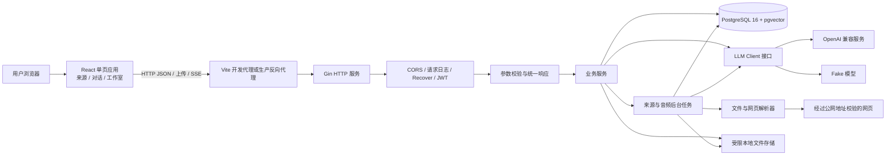
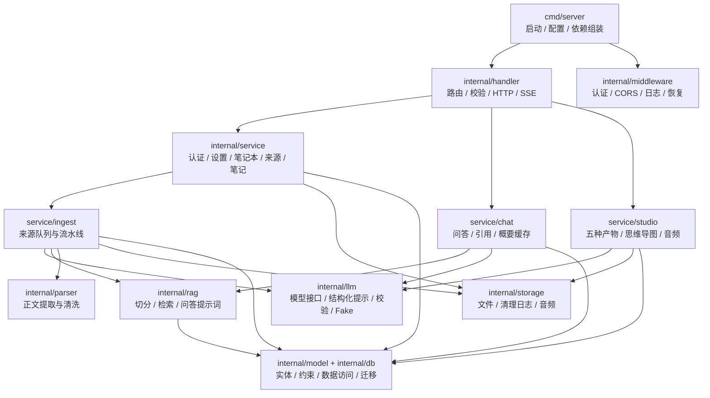
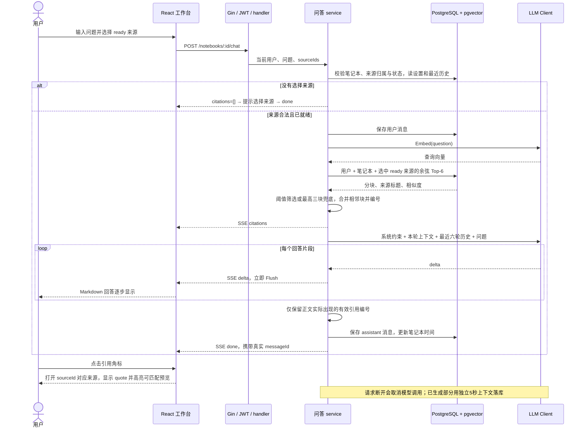
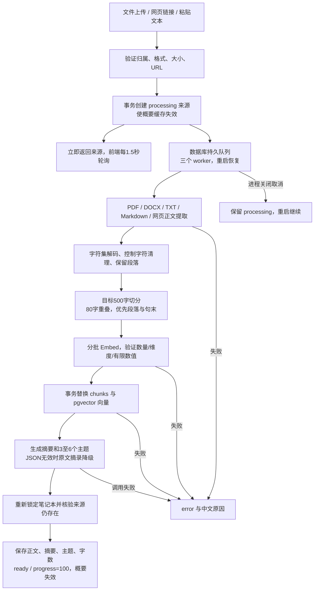

# 知页 KnowNote 架构设计

版本：T12（收尾整合），2026-11-15。本文描述仓库已实现的单进程部署形态，接口字段以 [api.md](api.md) 为准。全局整合报告见 [开发总结报告.md](开发总结报告.md)。

## 1. 设计目标与总体架构

系统以笔记本聚合个人资料，将来源解析、向量检索、可追溯问答和学习内容生成组合成闭环。前后端分离，结构化数据与向量存于同一 PostgreSQL 数据库，上传文件和音频存于受限的本地数据目录。模型调用统一为接口，便于在真实服务与确定性 Fake 之间切换。



前端真实模式通过 `/api` 访问后端；开发代理指向 8080。后端启动时完成向量扩展与表结构迁移，再启动固定数量的后台 worker。普通接口返回 `{code,data,message}`，问答接口使用长连接 SSE。系统不依赖消息中间件，数据库中的 processing/generating 记录同时承担持久任务队列功能。

## 2. 模块划分与依赖



| 模块 | 责任与边界 |
|---|---|
| 前端 `src/api` | 封装 Bearer、统一错误、真实 XHR 上传、SSE UTF-8 解码、来源与音频轮询；组件不直接 fetch |
| 前端 `src/store` | zustand 登录/工作台状态，临时上传 ID 替换，切换/退出取消观察，防止旧请求回写 |
| handler | UUID/字段/类型/长度检查、业务错误转 HTTP、输出契约视图，隐藏内部路径与密码哈希 |
| service | user_id 归属检查、事务、一致性、任务发起和实体文件清理协调 |
| rag | 500/80 字切分、选中来源余弦 Top-K、上下文与历史隔离、回答风格 |
| llm | Chat / ChatStream / Embed / TTS；有限重试、结果维度校验、JSON 解析与离线降级 |
| storage/parser | os.Root 限定数据目录、格式解析、网页公网校验、大小与超时限制 |

## 3. RAG 问答时序



接口准备阶段的非法来源与越权仍返回普通 400/404；开始 SSE 后的生成错误返回 error 事件。空选择的真实 API 不调用模型，前端通常在发送前即提示选择来源。流中断后尚未收到 done 的本地回答没有持久 ID，刷新历史后可取得 ID 再反馈。

## 4. 来源处理流水线



上传最大 200MiB；文本、DOCX 解压正文和 PDF 提取正文另限制 20MiB，网页响应限制 10MiB。网页解析约 20 秒超时，来源任务总预算 10 分钟。网页在 DNS 解析和重定向时校验公网地址并连接已验证 IP，避免访问内网资源。扫描 PDF 不执行 OCR；旧 DOC 不转换；音视频当前写入明确的未转写占位说明，不代表已经分析真实媒体。

创建、删除和 worker 最终写入均按同一顺序锁定笔记本，防止删除后重建任务结果。清理失败写入本地清理日志并定时重试；数据库与文件系统仍没有事务型 outbox。部署边界为单进程，不能将数据库队列当成支持多副本抢占的分布式队列。

## 5. 数据库 ER 图

数据库设计以 [数据库设计.md](数据库设计.md) 为唯一详细版本，包含全部 18 张表的总体 Mermaid E-R 图、关系说明、数据字典和索引清单。用户—设置、笔记本—概要/音频为 1:1；用户—笔记本/标签/日志/用量等为 1:N；笔记本—标签通过 notebook_tags、消息—分块/来源通过 message_citations 构成 M:N。

T10 将消息引用从 JSONB 迁入实体表，保留标题、摘录、位置与来源标识快照；来源/分块删除 SET NULL，消息删除 CASCADE。旧 JSONB 列保留但新代码不再写入，首次启动按版本迁移一次。标签整体替换在事务内校验用户归属；认证日志与邮箱 10 分钟失败限流使用数据库事务锁保护。

## 6. 接口概览

| 模块 | 主要接口 | 特性 |
|---|---|---|
| 健康与认证 | `GET /health`、`POST /auth/register`、`POST /auth/login` | 健康检查含数据库，重复邮箱 409、错误登录 401 |
| 用户 | `GET /me`、`GET/PATCH /me/settings` | 真实用户、配置及实时存储统计 |
| 笔记本 | `GET/POST /notebooks`、`GET/PATCH/DELETE /notebooks/:id` | CRUD、按更新时间倒序、删除级联 |
| 来源 | `GET/POST /notebooks/:id/sources`、`POST .../upload`、`GET/PATCH/DELETE /sources/:id` | multipart、异步处理、状态轮询 |
| 对话 | `POST /notebooks/:id/chat`、`GET/DELETE .../messages`、`POST /messages/:id/feedback` | SSE、持久化、反馈可清除 |
| 概要 | `GET /notebooks/:id/guide` | 缓存 Markdown 概要和三个推荐问题 |
| 笔记 | `GET/POST /notebooks/:id/notes`、`PATCH/DELETE /notes/:id` | Markdown、部分更新 |
| 产物 | `GET/POST /notebooks/:id/artifacts`、`DELETE /artifacts/:id` | 同步生成五种内容，导图校验重试 |
| 音频 | `GET/POST /notebooks/:id/audio`、`GET /files/audio/:file` | 异步脚本/可选 TTS、文件 Range、鉴权 |

所有路径带 `/api` 前缀，除认证和健康外均需 JWT；跨用户资源统一返回 404，避免泄露资源是否存在。JSON 使用 camelCase，时间为 RFC3339，列表无数据时返回空数组。

## 7. 关键技术与取舍

### 7.1 切分策略

按 Unicode 字符处理中文，目标 500 字，在后半区间优先选段落末尾，其次选句末，否则按字符截断。下一块保留前块末尾精确 80 字。少于 100 字的尾段并入上一块，最大 599 字，避免极短碎片。该策略无需特定 tokenizer，易于复现；代价是 token 预算仅为字符估计，不能完整保持跨多个段落的语义结构。

### 7.2 向量检索与 HNSW

分块向量与结构化归属存于同库。余弦相似度为 `1 - (embedding <=> query_vector)`；只在当前用户、笔记本、选中且 ready 的来源内排序，默认 Top-6。索引定义为 `USING hnsw (embedding vector_cosine_ops)`。HNSW 为近似索引，适合扩展资料数量；小数据集可能由优化器选择顺序扫描，建有索引不等于每次查询都使用索引。当前未做大规模召回率或并发容量评估。

相似度 ≥0.2 的非空块优先作为上下文；若全部低于阈值，则按得分保留最高的至多三块并记录警告。相邻块可能合并为一个引用。这个兜底避免 Fake 下因特征稀疏没有任何依据，但不证明片段能回答问题，提示词仍要求资料不足时说明。

### 7.3 引用标注与校验

同来源连续块先按原文位置合并，去掉最多 80 字重叠；合并组按首次检索排名分配 `[1]...[n]`。quote 为合并内容前 150 个 Unicode 字符并折叠空白。系统提示要求模型只依据本轮资料、逐句引用、不得编造编号；历史引用不作为本轮依据。

保存回答时只保留正文实际出现且存在于检索候选中的编号，保留原编号。前端用编号匹配 citation 并打开 sourceId，展示 quote；引用落在前 3000 字之外时仍展示引用框，原文预览不一定包含它。来源删除后旧引用保留快照，角标显示失效。当前校验保证引用编号与资料关联，不是对事实是否被片段支持的语义证明，也不能强制任意外部模型一定输出角标。

### 7.4 SSE 流式与取消

一次 POST 同时提交问题和来源集合。服务按 citations→delta…→done 的顺序写单行 JSON，并逐事件 Flush；`X-Accel-Buffering: no` 防止兼容代理缓冲。前端处理 UTF-8 字节边界、LF/CRLF、多行 data 与错误事件，done 使用真实消息 ID。取消传递到 LLM，上下文取消后使用独立、有限的保存时间落库部分回答，不继续生成。生产反向代理仍需显式允许长连接与关闭缓冲。

### 7.5 JWT、数据隔离与文件安全

JWT 使用 HS256，有效七天，校验算法、签名、签发者、过期时间与 UUID subject。所有业务查询包含 user_id 约束，复合外键提供第二层保护。日志不输出请求体、查询 token、SQL 参数或模型密钥。文件访问以 os.Root 限制 DATA_DIR，校验路径与 UUID，避免路径穿越和符号链接越界。

音频文件接受 Bearer，也接受同源 URL 的 `?token=` 供 audio 标签播放，归属检查后返回私有响应并支持 Range。当前退出是客户端清除 token 与工作台任务，JWT 未做服务端撤销，在过期前仍有效；生产部署需 HTTPS。存储总量 5GiB 为展示统计，当前不提供配额强制拦截。

### 7.6 Fake、结构化生成与可测试性

未配置 Key 时自动使用确定性 Fake：词袋特征哈希与归一化向量模拟检索；聊天摘录本轮资料并带编号，逐字输出便于观察取消；摘要采用原文摘录，主题使用中文常用词最长匹配、自然分隔短词和英文词频，过滤纯数字，词汇不足时补通用主题。词表并非通用中文分词模型，领域外资料仍可能只有概览类主题。

工作室使用不同提示词模板，导图严格限制四层、八分支、标签 1～20 字，解析失败重试一次；上下文 JSON 限制 12000 字。音频脚本校验双主持与1200～1800字，不配置 TTS 时仅文稿。真实兼容客户端本地模拟测试覆盖请求、限流重试、向量分批重排、流式中断与 TTS；百炼 text-embedding-v 系列限制每批十条。真实服务的效果、网络时延与语音解码仍需独立验证，Fake 不承担语义质量指标。

## T9：分能力模型、额度与图像扩展点

`llm.Capabilities` 保留既有 Client 接口，分别将 Chat/ChatStream、Embed、TTS 委派到独立 BaseURL、Key 与模型的 OpenAI 兼容客户端或 Fake。T9 的环境配置优先级为能力环境变量 → 对应旧 LLM_* → 原默认值；T11 再在其上增加数据库覆盖层。真实服务失败返回错误，不隐式切换 Fake。启动日志只记能力、域名、模型和模式；真实向量启动前探测一条短文本，迁移再校验 chunks.embedding 的列维度。T11 后同维度更换向量空间可在后台重建，修改维度仍须执行 scripts/reindex.sh：独立维护进程锁住来源和分块，在事务内保留分块元数据、重建向量列与 HNSW，失败回滚；不会读取密钥文件。

所有业务模型调用先显式绑定 `llm.WithUser(ctx, userID)`，包括来源和音频后台 worker。`llm.Guard` 对前台与后台统一做并发准入、每日额度、每分钟限速与用量记录。`llm_usage` 的 user_id 外键级联用户，常用查询索引为 (user_id, created_at)，字段包括 capability、model、prompt_tokens、completion_tokens、duration_ms、success，以及 pending/reserved_tokens。数据库 advisory 事务锁串行化每用户的额度检查与预留，防止跨请求/跨实例穿透；调用完成或取消后用独立短超时结算，缺 usage 时按字符估算。异常退出超过五分钟的未结算预留在下一次准入时按预算保守计入，避免重启绕过额度。没有保存提示词、回答或密钥。全局并发信号量为单进程；多实例部署需要另加跨实例并发协调，现有后台队列仍面向单实例。

图像生成独立使用接口：

```go
type ImageClient interface {
    Generate(ctx context.Context, prompt string, opts ImageOptions) (ImageResult, error)
}
```

`llm.NewImage(config, store)` 提供 OpenAI 兼容 `/images/generations`，统一将 b64_json 或下载的 url 字节保存为 `images/<userID>/<uuid>.png|jpg`，返回对象键、类型和尺寸；下载图片不转发模型 Key，存储兼容 T7 的 local/OSS。Fake 绘制带提示词的 PNG，优先系统中文字体，缺少字体时使用 Unicode 转义表示。`IMAGE_PROVIDER` 留空时目录标记关闭，没有 Key 的内部调用使用 Fake。dashscope 值预留给兼容模式，百炼原生异步任务提交/轮询需要另写适配器。本版本没有图像业务 API 或前端入口，不会自动触发图片费用。

以后接入工作室“生成封面/信息图”时：先按当前用户查询笔记本归属与 ready 来源，将其摘要构造成提示词；在现有 Guard 的额度/并发框架内补充 image 计量；调用 ImageClient，业务表只保存对象键，读取时按用户鉴权后通过 Store 提供文件或 OSS 签名 URL。需同时补充图片对象的业务归属、删除清理、失败重试和接口契约，再添加界面。供应商原生协议只增加 ImageClient 实现，不修改 RAG 的 Client 接口。


## T11：配置热更新

模型、存储与额度按数据库 system_settings → 启动环境（能力变量、旧 LLM_* 回退）→ 内置默认读取。环境文件仅由已有 dev.sh 注入；服务不读取 .env。后台开放对话、向量、阿里云 OSS 存储（`STORAGE_DRIVER` 与 `OSS_*` 共七项）及每日额度十六项，API Key 与 OSS `AccessKey ID` / `AccessKey Secret` 使用 AES-GCM 加密入库，响应只含掩码及来源；主密钥变化解密失败时警告并回退环境配置。

管理保存先合并和校验候选配置，再构造客户端/存储探测受影响能力：对话发送极短消息，向量嵌入短文本并校验固定列维度，切换 `STORAGE_DRIVER=oss` 时校验 Bucket 与前缀列举权限（`ListObjectsV2`）。测试失败不写库；成功后将配置与脱敏审计一并提交，再通过 `llm.Provider` 的 `atomic.Pointer` 发布不可变客户端/配置快照，并通过 `storage.Switchable` 原子热切换本地/OSS 存储实例。Guard 在每次 Chat、ChatStream、Embed、TTS 开始时获取当前客户端，额度在每次准入时读取当前配置；全部问答、摘要、工作室和后台任务使用该 Guard。进行中的流持有旧客户端至结束，不被替换中断；模型列表与用户默认模型回退同步读取新快照。

向量模型或地址变化会提示旧资料需重建。管理员按钮异步复用 T9 事务逻辑，保留原文、分块 ID、页码、引用关系与文件，失败整体回滚；任务固定开始时的向量客户端，同一进程最多一个，重建期间拒绝更换向量配置。sources/chunks 排他锁可能使业务读写等待，进度为事务内暂存处理数；任务进度与重建提示不跨进程重启保存。重建使用各资料用户的额度，允许管理员在过程中调整额度。

所有业务请求在 JWT 后查库确认账号可用，管理员接口再读取 role；停用或角色撤销对后续请求立即生效。管理员更改用户在数据库事务锁内检查不能自停用、自撤权或移除最后一位可用管理员。配置、账号变更与重建启动均写 audit_logs，仅记录键名、目标 UUID 和固定中文说明。

当前面向单实例。多实例部署可在配置提交后发布版本通知，各实例重新加载并原子替换 Provider，同时将重建任务状态与互斥迁入数据库；主密钥需各实例一致，不能仅共享数据库却各自热更新。

## T12：工作室教学文稿导出、RAG 检索生成与管理员配置隔离

工作室在原有五种学习辅助产物基础上，新增面向教学的三种主文档流派：**PPT 课件（`ppt`）**、**Word 文档（`word`）**与 **PDF 讲义（`pdf`）**，支持用途预设（`preset`）及双检索模式：未输入主题时复用勾选来源摘要生成（`retrievalMode: "summary"`）；输入备课主题/要求（`topic`）时通过 `Client.Embed` 与 `rag.Retriever.Search` 在勾选且 `ready` 来源分块中执行 pgvector 向量检索（`retrievalMode: "rag"`）后再生成结构化结果。`ppt` 产物额外持久化 `SlideDeck`（幻灯片板式、要点与演讲者备注 `notes`）。

二进制导出由 `internal/exporter` 统一提供：纯 Go 生成符合 OOXML 规范的 16:9 宽屏 `.pptx`（含备注页）与 `.docx`，以及从 Markdown/思维导图跨格式转换为 `.docx`/`.pptx`/`.md`；导出 PDF 时先组装中间文件并调用 `parser.Convert`（LibreOffice headless + 中文字体映射）输出真实 PDF。`GET /api/artifacts/:id/export` 与 `GET /api/notes/:id/export` 在用户归属校验后直接返回下载或内嵌预览流，前端 `ArtifactViewer` 支持幻灯片预览及 PDF `<iframe>` 内联预览。

权限上收口为**仅管理员可查看和配置模型与系统参数**：`GET /api/models` 挂载管理员中间件（非管理员 `403`）；`PATCH /api/me/settings` 禁止非管理员修改 `model`（返回 `403` / `40301`），`GET /api/me/settings` 对普通用户隐藏 `model` 字段，普通用户的问答与工作室生成一律由服务端解析为系统当前激活模型执行。
