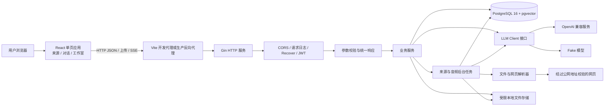
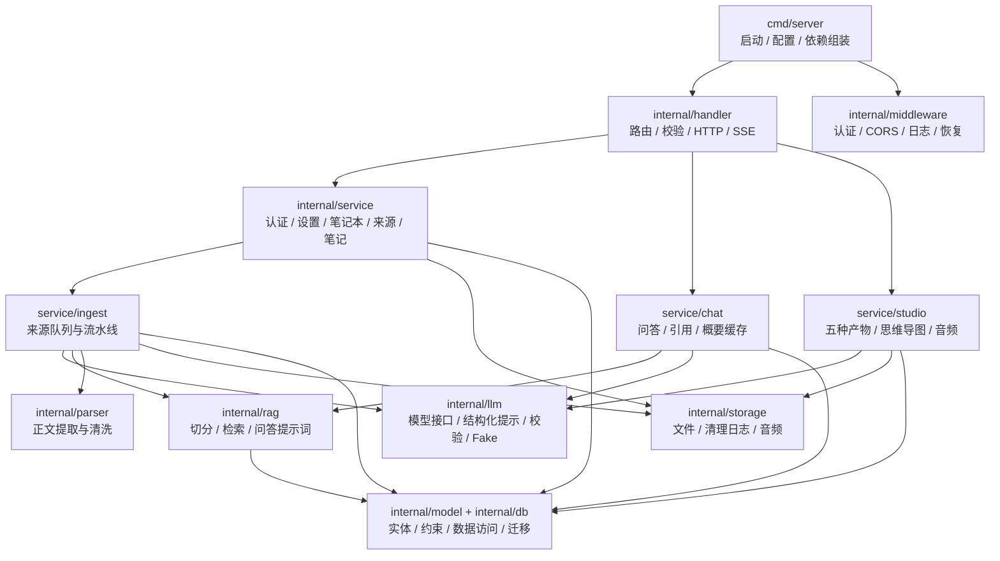
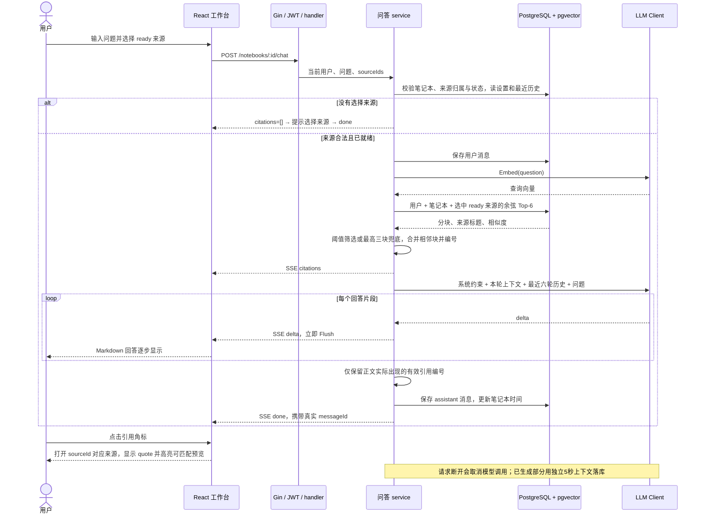
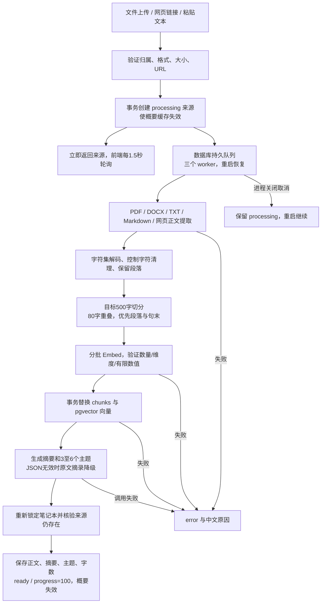
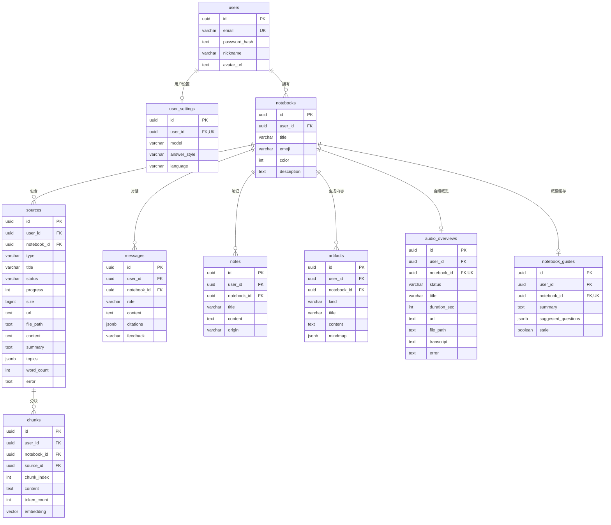

# 知页 KnowNote 架构设计

版本：T6，2026-11-14。本文描述仓库已实现的单进程部署形态，接口字段以 [api.md](api.md) 为准。

## 1. 设计目标与总体架构

系统以笔记本聚合个人资料，将来源解析、向量检索、可追溯问答和学习内容生成组合成闭环。前后端分离，结构化数据与向量存于同一 PostgreSQL 数据库，上传文件和音频存于受限的本地数据目录。模型调用统一为接口，便于在真实服务与确定性 Fake 之间切换。

前端真实模式通过 `/api` 访问后端；开发代理指向 8080。后端启动时完成向量扩展与表结构迁移，再启动固定数量的后台 worker。普通接口返回 `{code,data,message}`，问答接口使用长连接 SSE。系统不依赖消息中间件，数据库中的 processing/generating 记录同时承担持久任务队列功能。

## 2. 模块划分与依赖

| 模块 | 责任与边界 |
|---|---|
| 前端 `src/api` | 封装 Bearer、统一错误、真实 XHR 上传、SSE UTF-8 解码、来源与音频轮询；组件不直接 fetch |
| 前端 `src/store` | zustand 登录/工作台状态，临时上传 ID 替换，切换/退出取消观察，防止旧请求回写 |
| handler | UUID/字段/类型/长度检查、业务错误转 HTTP、输出契约视图，隐藏内部路径与密码哈希 |
| service | user_id 归属检查、事务、一致性、任务发起和实体文件清理协调 |
| rag | 500/80 字切分、选中来源余弦 Top-K、上下文与历史隔离、回答风格 |
| llm | Chat / ChatStream / Embed / TTS；有限重试、结果维度校验、JSON 解析与离线降级 |
| storage/parser | os.Root 限定数据目录、格式解析、网页公网校验、大小与超时限制 |

## 3. RAG 问答时序

接口准备阶段的非法来源与越权仍返回普通 400/404；开始 SSE 后的生成错误返回 error 事件。空选择的真实 API 不调用模型，前端通常在发送前即提示选择来源。流中断后尚未收到 done 的本地回答没有持久 ID，刷新历史后可取得 ID 再反馈。

## 4. 来源处理流水线

上传最大 200MiB；文本、DOCX 解压正文和 PDF 提取正文另限制 20MiB，网页响应限制 10MiB。网页解析约 20 秒超时，来源任务总预算 10 分钟。网页在 DNS 解析和重定向时校验公网地址并连接已验证 IP，避免访问内网资源。扫描 PDF 不执行 OCR；旧 DOC 不转换；音视频当前写入明确的未转写占位说明，不代表已经分析真实媒体。

创建、删除和 worker 最终写入均按同一顺序锁定笔记本，防止删除后重建任务结果。清理失败写入本地清理日志并定时重试；数据库与文件系统仍没有事务型 outbox。部署边界为单进程，不能将数据库队列当成支持多副本抢占的分布式队列。

## 5. 数据库 ER 图

所有实体均具有 UUID 主键与 `created_at/updated_at`。下图省略重复时间字段；数据库使用复合外键约束笔记本与子资源属于同一用户。

### 关键字段与约束说明

| 表或字段 | 设计含义 |
|---|---|
| `users.email/password_hash` | 邮箱大小写归一、唯一约束；bcrypt 哈希，不返回密码字段 |
| `user_settings` | 每用户一条，保存聊天模型、风格、语言；存储用量由来源 size 实时汇总，非可写字段 |
| `notebooks (id,user_id)` | 复合唯一键作为子资源的归属参照；标题、emoji、0～7 的颜色 |
| `sources.status/progress/error` | processing→ready/error；上传 uploading 为前端临时状态；取消处理保留 processing |
| `sources.content/summary/topics` | 保存完整清洗正文、120～200 字摘要、3～6 个 JSONB 主题；接口只提供前 3000 字预览 |
| `sources.file_path` | 相对 DATA_DIR 的内部路径，禁止返回客户端；size 为上传实际字节数 |
| `chunks.embedding` | 默认 vector(1536)，创建 HNSW 余弦索引；维度来自 EMBEDDING_DIM，迁移时检查兼容 |
| `chunks (source_id,chunk_index)` | 来源内位置唯一；复合外键关联 source_id/notebook_id/user_id，删除来源级联删除块 |
| `chunks.token_count` | 非空白字符数的估算，不等同于 tokenizer 的实际 token 数 |
| `messages.citations` | JSONB 保存 index/sourceId/sourceTitle/quote 快照；编号不因过滤重新排列 |
| `notes.origin` | manual/chat/studio；保存 Markdown，updated_at 倒序展示 |
| `artifacts.kind/mindmap` | 五种枚举内容；导图保存已校验、补齐 UUID 的树形 JSON |
| `audio_overviews` | 每笔记本唯一，generating/ready/error，存脚本及可选文件路径；duration_sec 按文本速率估算 |
| `notebook_guides.stale` | 来源变化后置 true；缓存保存前复核来源指纹，避免旧结果覆盖新状态 |

用户、笔记本、来源删除使用数据库外键级联；笔记本还安排上传和音频文件清理。列表索引包含用户、笔记本及排序时间。`sourceCount`、`storageUsed` 为查询统计值，不维护易失真的冗余计数列。

## 6. 接口概览

| 模块 | 主要接口 | 特性 |
|---|---|---|
| 健康与认证 | `GET /health`、`POST /auth/register`、`POST /auth/login` | 健康检查含数据库，重复邮箱 409、错误登录 401 |
| 用户 | `GET /me`、`GET/PATCH /me/settings` | 真实用户、配置及实时存储统计 |
| 笔记本 | `GET/POST /notebooks`、`GET/PATCH/DELETE /notebooks/:id` | CRUD、按更新时间倒序、删除级联 |
| 来源 | `GET/POST /notebooks/:id/sources`、`POST .../upload`、`GET/PATCH/DELETE /sources/:id` | multipart、异步处理、状态轮询 |
| 对话 | `POST /notebooks/:id/chat`、`GET/DELETE .../messages`、`POST /messages/:id/feedback` | SSE、持久化、反馈可清除 |
| 概要 | `GET /notebooks/:id/guide` | 缓存 Markdown 概要和三个推荐问题 |
| 笔记 | `GET/POST /notebooks/:id/notes`、`PATCH/DELETE /notes/:id` | Markdown、部分更新 |
| 产物 | `GET/POST /notebooks/:id/artifacts`、`DELETE /artifacts/:id` | 同步生成五种内容，导图校验重试 |
| 音频 | `GET/POST /notebooks/:id/audio`、`GET /files/audio/:file` | 异步脚本/可选 TTS、文件 Range、鉴权 |

所有路径带 `/api` 前缀，除认证和健康外均需 JWT；跨用户资源统一返回 404，避免泄露资源是否存在。JSON 使用 camelCase，时间为 RFC3339，列表无数据时返回空数组。

## 7. 关键技术与取舍

### 7.1 切分策略

按 Unicode 字符处理中文，目标 500 字，在后半区间优先选段落末尾，其次选句末，否则按字符截断。下一块保留前块末尾精确 80 字。少于 100 字的尾段并入上一块，最大 599 字，避免极短碎片。该策略无需特定 tokenizer，易于复现；代价是 token 预算仅为字符估计，不能完整保持跨多个段落的语义结构。

### 7.2 向量检索与 HNSW

分块向量与结构化归属存于同库。余弦相似度为 `1 - (embedding <=> query_vector)`；只在当前用户、笔记本、选中且 ready 的来源内排序，默认 Top-6。索引定义为 `USING hnsw (embedding vector_cosine_ops)`。HNSW 为近似索引，适合扩展资料数量；小数据集可能由优化器选择顺序扫描，建有索引不等于每次查询都使用索引。当前未做大规模召回率或并发容量评估。

相似度 ≥0.2 的非空块优先作为上下文；若全部低于阈值，则按得分保留最高的至多三块并记录警告。相邻块可能合并为一个引用。这个兜底避免 Fake 下因特征稀疏没有任何依据，但不证明片段能回答问题，提示词仍要求资料不足时说明。

### 7.3 引用标注与校验

同来源连续块先按原文位置合并，去掉最多 80 字重叠；合并组按首次检索排名分配 `[1]...[n]`。quote 为合并内容前 150 个 Unicode 字符并折叠空白。系统提示要求模型只依据本轮资料、逐句引用、不得编造编号；历史引用不作为本轮依据。

保存回答时只保留正文实际出现且存在于检索候选中的编号，保留原编号。前端用编号匹配 citation 并打开 sourceId，展示 quote；引用落在前 3000 字之外时仍展示引用框，原文预览不一定包含它。来源删除后旧引用保留快照，角标显示失效。当前校验保证引用编号与资料关联，不是对事实是否被片段支持的语义证明，也不能强制任意外部模型一定输出角标。

### 7.4 SSE 流式与取消

一次 POST 同时提交问题和来源集合。服务按 citations→delta…→done 的顺序写单行 JSON，并逐事件 Flush；`X-Accel-Buffering: no` 防止兼容代理缓冲。前端处理 UTF-8 字节边界、LF/CRLF、多行 data 与错误事件，done 使用真实消息 ID。取消传递到 LLM，上下文取消后使用独立、有限的保存时间落库部分回答，不继续生成。生产反向代理仍需显式允许长连接与关闭缓冲。

### 7.5 JWT、数据隔离与文件安全

JWT 使用 HS256，有效七天，校验算法、签名、签发者、过期时间与 UUID subject。所有业务查询包含 user_id 约束，复合外键提供第二层保护。日志不输出请求体、查询 token、SQL 参数或模型密钥。文件访问以 os.Root 限制 DATA_DIR，校验路径与 UUID，避免路径穿越和符号链接越界。

音频文件接受 Bearer，也接受同源 URL 的 `?token=` 供 audio 标签播放，归属检查后返回私有响应并支持 Range。当前退出是客户端清除 token 与工作台任务，JWT 未做服务端撤销，在过期前仍有效；生产部署需 HTTPS。存储总量 5GiB 为展示统计，当前不提供配额强制拦截。

### 7.6 Fake、结构化生成与可测试性

未配置 Key 时自动使用确定性 Fake：词袋特征哈希与归一化向量模拟检索；聊天摘录本轮资料并带编号，逐字输出便于观察取消；摘要采用原文摘录，主题使用中文常用词最长匹配、自然分隔短词和英文词频，过滤纯数字，词汇不足时补通用主题。词表并非通用中文分词模型，领域外资料仍可能只有概览类主题。

工作室使用不同提示词模板，导图严格限制四层、八分支、标签 1～20 字，解析失败重试一次；上下文 JSON 限制 12000 字。音频脚本校验双主持与1200～1800字，不配置 TTS 时仅文稿。真实兼容客户端本地模拟测试覆盖请求、限流重试、向量分批重排、流式中断与 TTS；百炼 text-embedding-v 系列限制每批十条。真实服务的效果、网络时延与语音解码仍需独立验证，Fake 不承担语义质量指标。
